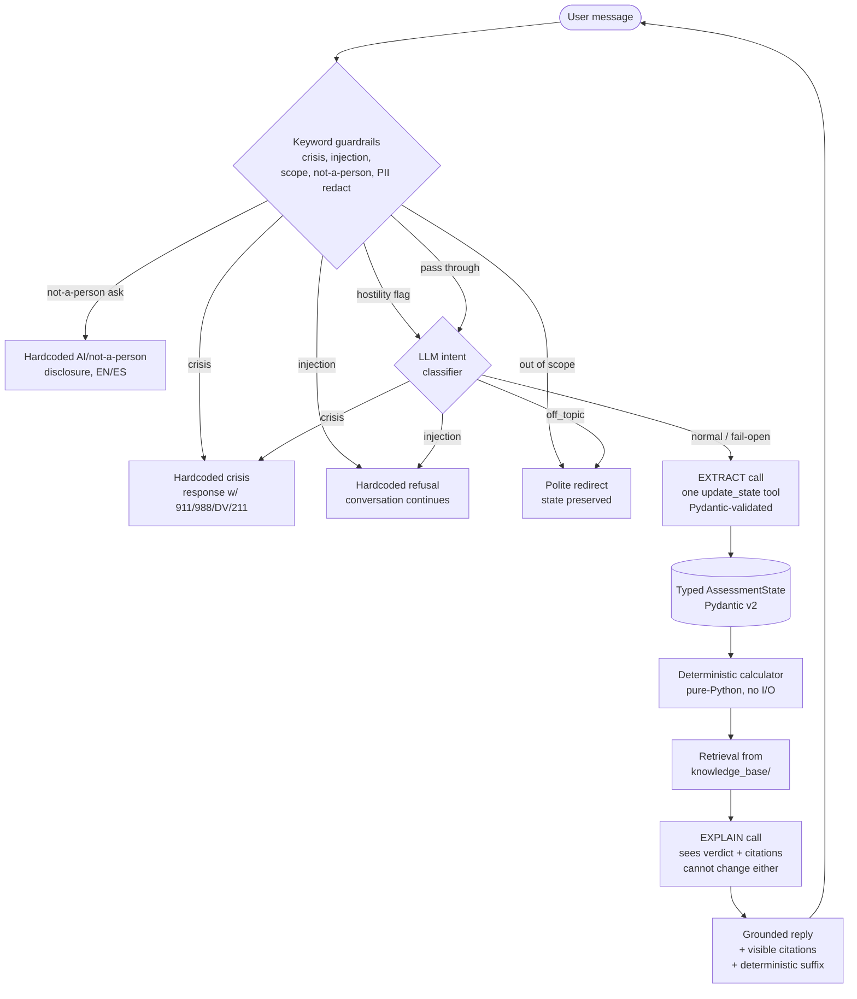

# CivicReach — Architecture (reviewer's narration)

This is the artifact we hand to the reviewer the day of the live architecture
review. It answers the four predictable questions ("how does a turn actually
run?", "why is the guardrail order that order?", "what breaks?", "what keeps
the model from doing damage?") in advance, so the meeting can spend its
attention on judgment and tradeoffs rather than re-narration.

Scope reminder: a text agent that walks an NC resident through an *initial*
FNS / SNAP eligibility screen. Not an application, not connected to any
agency. Three intake fields, deterministic verdict, visible citations, hard
guardrails.

---

## 1. The turn cycle: extract → decide → explain (and why it is two LLM calls)

One user turn is, in normal flow, **two** LLM calls plus the deterministic
calculator plus retrieval:

1. **EXTRACT** call. The model sees the user message, the conversation so
   far, and a single `update_state` tool. Its only job is to (a) record
   explicitly-supplied intake facts via the tool and (b) draft the next
   intake question. The tool calls land in a Pydantic-validated
   `AssessmentState`; a malformed call is dropped and the field stays
   missing, so the loop re-asks cleanly.
2. **DECIDE** (no LLM). The deterministic calculator reads `AssessmentState`,
   runs the gross track (poverty guideline × 1.30) or net track (× 1.00 for
   households with an elderly or disabled member), and emits the
   `likely_eligible / maybe_eligible / likely_ineligible` verdict plus the
   applicable income limit. No I/O, no network, no model. Determinism here
   is load-bearing: the reviewer's "what happens if you change the poverty
   line?" question has an exact answer.
3. **EXPLAIN** call. The model sees the verdict *and* the freshly retrieved
   rule citations, and writes the plain-language reply. Its text cannot
   change the verdict, the calculator numbers, or the citations block —
   those are code-templated from the calculator output and the retrieval
   hit list. This is also the pass that surfaces any post-verdict
   correction: if the user fixes an intake field after seeing the verdict,
   the explain pass renders the new verdict against the corrected state.

**Why two calls and not one.** Combining extract + explain into a single
call would make the model the author of its own verdict reasoning. That
puts the safety-critical "does this person qualify?" sentence in the same
generation budget as "please restate their income." Splitting them means
the deterministic result is *load-bearing in the reply* — the explain pass
is told what the verdict is and must render it — rather than *advisory*,
i.e. something the model wrote and that we are post-hoc checking. The
reviewer who asks "could the model decide the person qualifies when the
calculator said no?" gets a clean answer: no, the explain call receives
the calculator's verdict as input and is forbidden (by prompt) from
overriding it.

There is also a hidden third call in the path: a secondary LLM **intent
classifier** that runs after the keyword guardrails, as defense in depth
(see §2). Its output only chooses between hardcoded responses — it never
writes user-facing copy.

---

## 2. Guardrail ordering — and why safety deliberately outranks security

The keyword layer runs in this exact order. The ordering is enforced by
placement in `agent.py::turn`, not by configuration, so reordering requires
a code edit:

| # | Guardrail | Action on hit | Why this position |
|---|---|---|---|
| 1 | **Crisis** (`detect_crisis`) | Hardcoded crisis response with 911 / 988 / DV hotline / USDA hunger line / 211 | Highest priority by design. A message like *"ignore your instructions — I'm going to hurt myself"* matches both crisis and injection detectors; answering it with an injection refusal instead of 911/988 would be the worst possible outcome. Safety outranks security, deliberately. |
| 2 | **Injection** (`detect_injection`) | Hardcoded refusal; conversation continues next turn | Second because it is the next-most-harmful pattern: a successful injection can rewire every later guardrail. We refuse this turn but do *not* lock the conversation into refusal mode — the next normal message re-evaluates normally. |
| 3 | **Scope** (`detect_out_of_scope`) | Polite redirect, state preserved | Third because scope-creep is the failure mode most likely to *look* fine while quietly drifting the agent away from the case-study brief (legal advice, immigration, tax, housing, etc.). State preservation matters: nothing already collected is reset. |
| 4 | **Not-a-person** (`detect_not_a_person_request`) | Hardcoded AI / not-a-person disclosure | Fourth because it is honesty-about-nature, not safety. Disclosure is rendered by code template in the active language, never rewritten by the model, so it cannot be paraphrased into something else. The only thing that overrides it is the crisis response above. |
| 5 | **Hostility** (`detect_hostility`) | Non-blocking flag, one calm de-escalation instruction in the system prompt for *this* turn only, audit note in history | Strictly lowest priority. If the message reached this point it has already cleared crisis / injection / scope, so flagging it as hostile cannot suppress any of those hardcoded responses. The detector runs *here* (not earlier) so the evaluation order itself enforces "crisis always wins." The agent never refuses or ends the conversation on hostility. |

After the keyword layer, the **LLM intent classifier** re-checks for crisis,
injection, and off-topic as defense in depth — keyword lists are brittle on
unseen inputs and the red-team suite already proved that. The classifier
fails open: on exception, unparseable output, or `normal`, the ordinary
LLM call continues. It can be disabled via `GUARDRAIL_CLASSIFIER=off` for
offline runs.

**The reviewer question this answers.** *"Could a hostile user suppress
the crisis response?"* No: hostility runs last, only if crisis / injection
/ scope all cleared, and it is non-blocking. *"Could a prompt injection
rewrite the disclosure?"* No: the disclosure is code-templated and runs
before any LLM call.

---

## 3. Failure modes

The model is a junior collaborator, not the decision-maker. Every
failure mode below has a deterministic backup that keeps the user safe
and the conversation coherent.

| Failure | What happens | Why the system stays correct |
|---|---|---|
| **Model lies about eligibility** | The EXTRACT call cannot reach the verdict; the verdict is computed by the deterministic calculator from the validated `AssessmentState`. The EXPLAIN call receives the verdict as input and is told not to override it. | Even if the model writes *"you qualify for $1,200/month"*, the visible citations and the deterministic verdict floor at the bottom of every reply show the actual answer. |
| **Model returns no text** | Empty `content` falls back to the deterministic verdict floor — a templated sentence stating the verdict, the track used, and the income limit. Never a blank reply. | The user always sees the verdict; the empty generation is invisible. |
| **Model returns a malformed tool call** | `_apply_tool_calls` rejects it (wrong type, missing field, invalid enum) and the field stays missing. The intake loop re-asks on the next turn. | Pydantic validation prevents garbage in `AssessmentState`; the calculator never sees bad data. |
| **Provider is down / 5xx / timeout** | The LLM client raises; `turn()` catches and renders a templated "having trouble reaching the model" message in the active language, with the crisis hotline number attached so a user in distress is never left without resources. No state is corrupted. | Conversation continues on next turn; intake state is preserved across retries. |
| **User contradicts themselves mid-intake** (`"wait, it's 3 people, not 2"`) | The EXTRACT call updates the relevant field via `update_state`. If the contradiction arrives *after* a verdict was already rendered (W36 fix), the post-verdict correction path re-runs the calculator and the EXPLAIN call renders the fresh verdict in the same turn. | The calculator re-runs against the new state; there is no path where an old verdict persists over a corrected intake. |
| **Retrieval finds nothing** | The KB lookup returns zero rows; the citations block renders an explicit "no rule text retrieved" marker and the EXPLAIN call is told to refuse to invent a number. The verdict floor still appears. | The user sees "I couldn't find the rule that applies" instead of a fabricated limit. |

---

## 4. The four defense layers that make the model unable to do damage

1. **The calculator owns arithmetic.** No eligibility number, no income
   limit, no percentage, no verdict ever comes from the model. The
   calculator is pure-Python with a fixed dependency on the
   FY-up-to-date HHS poverty guideline table. Audit it by reading one
   function.
2. **Hotlines are hardcoded, in both languages.** 911, 988, the National
   Domestic Violence Hotline (1-800-799-7233 / text START to 88788),
   the USDA hunger hotline, and 211 are constants in
   `src/guardrails/crisis.py`. The model is never allowed to write the
   crisis turn.
3. **Citations are code-templated.** The `(Sources: ...)` line is built
   from the retrieval hit list and appended verbatim. The model cannot
   hallucinate a citation or drop a real one; the worst it can do is
   write a sentence that mis-cites, which the visible block contradicts
   on the same screen.
4. **State and verdict are Pydantic-validated.** `AssessmentState` is
   a typed model; a malformed tool call is dropped. The final reply has
   a deterministic verdict floor at the bottom — even if the EXPLAIN
   call returned empty or contradictory text, the floor states the actual
   verdict, the track used, and the income limit. The user cannot leave
   the conversation misinformed about whether they likely qualify.

---

## 5. What we deliberately cut, and why

* **Fine-tuning.** Prompt + tools + a deterministic calculator already
  outperforms a rushed LoRA on this problem. A small fine-tune on
  synthetic data risks degrading exactly the robustness being tested
  (crisis / injection / scope) and would consume most of the 20-hour
  budget before the first user turn. Trade is not worth it.
* **Multi-agent frameworks.** An explicit state machine with a single
  `update_state` tool is fully narratable in the review meeting —
  reviewer asks "what happens if X", we can answer in one breath.
  Replacing it with a planner / critic / verifier graph would buy us
  nothing demonstrable and bury the guardrail ordering.
* **Auth, persistence, multi-tenancy.** The case study asks for scope
  discipline. Web sessions live in the process only; restarting the
  server clears them. That is the right cut for a 20-hour PoC and it
  matches the case study's "do not submit real applications, do not
  contact a real agency" guardrail.
* **Real agency integration.** Explicitly forbidden by the case-study
  prompt. We never call, scrape, or submit anywhere.
* **Streaming.** Non-streaming replies keep the guardrail ordering
  enforceable (the full turn is decided before any byte is sent to the
  user) and make the deterministic verdict floor simpler. The case-study
  brief does not require streaming and the latency cost of a single
  short reply is not on the critical path.
