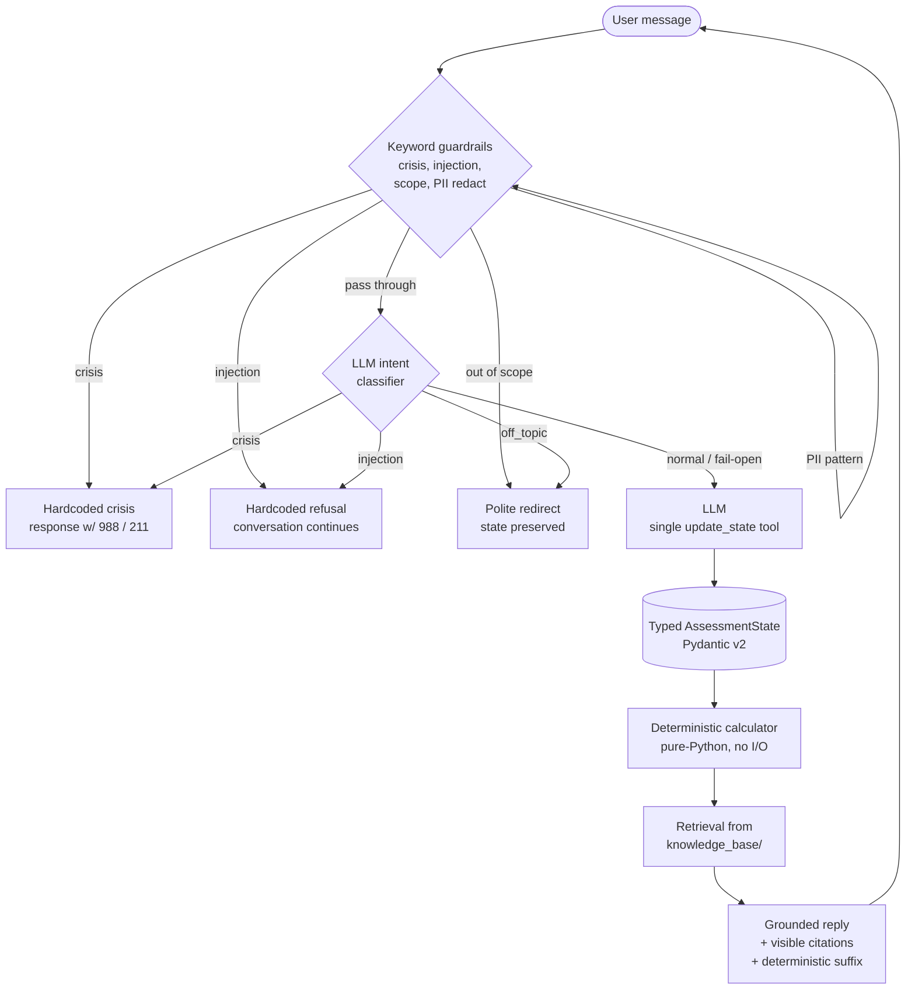

# CivicReach — NC FNS Eligibility Agent

## What this is

CivicReach is a proof-of-concept text agent that walks a North Carolina
resident through an *initial* Food and Nutrition Services (FNS / SNAP)
eligibility screen. It collects three intake fields across a multi-turn
conversation, grounds every answer in a small retrieval-augmented knowledge
base of public eligibility documents, and returns a deterministic
likely-eligible / maybe-eligible / likely-ineligible verdict plus
visible citations. It also layers deterministic guardrails (crisis,
prompt-injection, out-of-scope, PII redaction) and a secondary LLM
intent classifier in front of the main agent loop.

This is a case-study deliverable: scope is deliberately narrow. It is not
a real application, not connected to any agency, and the case study
explicitly forbids that.

## Quickstart

```bash
# 1. Create and activate a virtualenv
python3 -m venv .venv
source .venv/bin/activate

# 2. Install pinned dependencies
pip install -r requirements.txt

# 3. Configure your environment — you need ONE provider key
cp .env.example .env
# then edit .env and set exactly one of:
#   ANTHROPIC_API_KEY (LLM_PROVIDER=anthropic, default)
#   OPENAI_API_KEY    (LLM_PROVIDER=openai)
#   MINIMAX_API_KEY   (LLM_PROVIDER=minimax)
# Optional: set LLM_FALLBACK_PROVIDER for resilience on the live demo.

# 4a. Talk to the agent in the terminal
python3 -m src.cli

# 4b. OR run the local web UI (single-process, sessions live in memory)
uvicorn src.web:app --reload
# then open http://127.0.0.1:8000
```

Run the tests:

```bash
pytest -q
```

Run the red-team suite (crisis, injection, off-topic, ambiguous income,
correction across turns):

```bash
python3 -m redteam.run_redteam
```

## Architecture

The conversation loop is a layered, *narratable* state machine. Every
piece exists because it earns its place against the case-study rubric
(architectural judgment, guardrail thinking, failure-mode reasoning,
tradeoffs).



**Why each piece exists**

* *Keyword guardrails first.* They are fast, deterministic, auditable,
  and work offline. Crisis must be evaluated before injection: a message
  like "ignore your instructions — I'm going to hurt myself" matches
  both detectors, and answering it with an injection refusal instead of
  988 / 211 resources would be the worst possible outcome. Safety
  outranks security here, deliberately.
* *LLM intent classifier as defense in depth.* Keyword lists are brittle
  on unseen inputs — the red-team suite already proved that. The
  classifier catches novel phrasings; on any classifier failure
  (exception, unparseable output, "normal") we fail open and let the
  ordinary LLM call continue. It can be disabled via
  `GUARDRAIL_CLASSIFIER=off` for offline runs.
* *PII redaction.* A redactor strips SSN- and account-shaped patterns
  from every user message *before* it is recorded in the conversation
  history, so any later log dump is PII-safe.
* *LLM + a single `update_state` tool.* The model is not asked to do
  arithmetic or to memorize eligibility rules. Its only job is to ask
  the next intake question and record explicitly-supplied facts. This
  keeps the model honest and the test surface small.
* *Typed assessment state (Pydantic).* All collected facts live in a
  validated `AssessmentState`. The model cannot write garbage into it;
  a malformed tool call is dropped and the field stays missing so the
  loop re-asks on the next turn.
* *Deterministic calculator.* Pure-Python, no I/O, no network. The
  decision is a table lookup plus arithmetic against HHS 2025 poverty
  guidelines x 1.30 (gross track) or x 1.00 (net track, for households
  with an elderly or disabled member). All arithmetic happens here, not
  in the prompt.
* *Retrieval + visible citations.* Every final answer is appended with a
  code-templated `(Sources: ...)` line naming the documents retrieved for
  the applicable income track. The model does not write this line — it
  cannot be hallucinated.

## What we deliberately cut and why

* **Fine-tuning.** Prompt + tools + a deterministic calculator already
  outperforms a rushed LoRA on this problem. A small fine-tune on
  synthetic data risks degrading exactly the robustness being tested
  (crisis / injection / scope) and would consume most of the 20-hour
  budget before the first user turn. The trade is not worth it.
* **Multi-agent frameworks.** An explicit state machine with a single
  `update_state` tool is fully narratable in the review meeting —
  reviewer asks "what happens if X", we can answer in one breath.
  Replacing it with a planner / critic / verifier graph would buy us
  nothing demonstrable and bury the guardrail ordering.
* **Auth, persistence, multi-tenancy.** The case study asks for scope
  discipline. Web sessions live in the process only; restarting the
  server clears them. That is the right cut for a 20-hour PoC and it
  matches the case study's "do not submit real applications, do not
  contact a real agency" guardrail.
* **Real agency integration.** Explicitly forbidden by the case study
  prompt. We never call, scrape, or submit anywhere.

## Guardrails

| Layer | What it catches | Why deterministic |
|---|---|---|
| Crisis keyword (`detect_crisis`) | Suicidal ideation, self-harm, domestic-violence, food-on-table emergencies, "I can't go on" phrasings | Returns a hardcoded response with 988 / 211 / DV hotline resources. The model is never allowed to write this turn. |
| Prompt-injection keyword (`detect_injection`) | "ignore previous instructions", "you are now DAN", "system:" spoofing, role-override attempts | Hardcoded refusal. The flag is recorded but does not lock the conversation into refusal mode — the next normal message is evaluated normally. |
| Out-of-scope keyword (`detect_scope`) | Legal advice, unrelated benefit programs, immigration questions, tax / housing / Medicaid | Polite redirect back to FNS questions. State is preserved; nothing already collected is reset. |
| PII redactor (`redact_for_logging`) | SSN-shaped, account-shaped, routing-shaped patterns | Strips from conversation history before it's logged, so any later dump is safe by construction. |
| LLM intent classifier (`classify_intent`) | Novel phrasings of the three above that the keyword lists miss | Defense in depth. Failure mode is fail-open: on any error or "normal" label, the agent proceeds to the normal LLM call. |
| `update_state` validation (Pydantic) | Out-of-range household_size, malformed income strings, type confusion | Drops the bad update, keeps state valid, re-asks the field next turn. |

A `GUARDRAIL_CLASSIFIER=off` environment variable disables the classifier
layer for tests, offline runs, and the model bake-off. The keyword
layers cannot be disabled — they are the floor.

## Known limitations

* **Initial screen, not a determination.** The agent returns a likely /
  maybe / unlikely verdict against the federal gross / net income tests.
  It is not a final agency determination, and the conversation banner
  and system prompt both say so. Real applicants still need to file with
  their county DSS.
* **Net-income deductions are simplified.** The federal net-income test
  subtracts the SNAP standard deduction, earned-income deduction,
  dependent-care deduction, medical deduction (elderly / disabled), and
  shelter deduction. The calculator folds the standard deduction into
  the limit and ignores the rest. The outcome band (130–200% of poverty)
  is widened to compensate: anyone in that band is told "maybe, talk to
  a case worker" rather than auto-denied.
* **Keyword + classifier is still not exhaustive.** New injection or
  crisis phrasings will keep arriving. The red-team suite (`redteam/`)
  is the regression net; new failure modes must be filed into
  `redteam/file_failures.py` and added to `attack_cases.jsonl` before the
  next iteration.
* **Income limits need an annual refresh.** HHS publishes new poverty
  guidelines late January / early February. The 2025 figures are in
  `src/calculator.py`; the calculator has a "see also" comment naming
  every constant to update. If the table falls behind, the calculator is
  slightly more permissive than the actual program — a known trade-off
  of the deterministic design.
* **Crisis keyword list is English-only.** Spanish-language crisis
  phrasings are not yet in the keyword set. Production would need
  bilingual lists plus a Spanish system prompt.
* **PII redactor is regex-only.** It catches SSN-shaped and
  account-shaped patterns; it does not catch free-form names, addresses,
  or phone numbers. Conversation history is therefore not fully
  anonymized — it just doesn't contain the worst-pattern identifiers.

## Production roadmap

What we would build next, in priority order, given more time:

1. **Real deduction math.** Compute the federal net-income test properly:
   standard deduction + earned-income deduction + dependent-care +
   medical (elderly / disabled) + shelter. This tightens the outcome
   band back to 130/100% and removes the "maybe" carve-out.
2. **Case-worker handoff.** A "talk to a human" handoff that produces a
   print-ready summary of the intake and the rule citations behind the
   screen, in plain English, so a DSS case worker can pick up mid-flow.
3. **Spanish localization.** Spanish system prompt, Spanish crisis /
   injection / scope keyword lists, Spanish knowledge-base chunks. The
   most-requested gap for any NC benefits tool.
4. **Telemetry with PII redaction.** First-class event log of every
   turn with the redactor applied at write-time, so we can see failure
   modes in production without ever persisting raw user input.
5. **Eval harness in CI.** A `pytest`-driven harness that runs the
   red-team suite plus a fixed transcript corpus on every PR, with a
   pass / fail threshold on outcome-band stability. Catches regressions
   before they reach a live demo.

## Repository layout

```
src/
  agent.py            # conversation loop, tool handling, correction tracking
  calculator.py       # deterministic eligibility arithmetic (HHS 2025)
  retrieval.py        # RAG over knowledge_base/
  llm_client.py       # provider-agnostic client (anthropic / openai / minimax)
  state.py            # typed Pydantic AssessmentState
  cli.py              # `python3 -m src.cli`
  web.py              # FastAPI UI: POST /chat, GET /, GET /health
  guardrails/
    crisis.py         # detect_crisis, crisis_response
    injection.py      # detect_injection, injection_response
    scope.py          # detect_out_of_scope, scope_redirect_message
    classifier.py     # LLM intent classifier (defense in depth)
    pii.py            # redact_for_logging
    ambiguity.py      # normalize_income ("$2,500", "$600/week" -> monthly float)

knowledge_base/       # 4 markdown chunks of public NC FNS rules
redteam/              # attack_cases.jsonl + run_redteam + failure file
tests/                # pytest suite (calculator, guardrails, agent, web)
scripts/              # one-off generators (KB income table, etc.)
```

## Safety

* The agent never asks for or stores a Social Security number, date of
  birth, home address, phone number, bank account number, driver's
  license number, or immigration status. The system prompt forbids it
  explicitly, and the `update_state` schema rejects it structurally.
* The agent does not submit applications, contact any agency, or
  scrape any government system.
* On crisis detection the agent returns 988 (Suicide & Crisis Lifeline)
  and 211 (United Way resources) and stops; it does not attempt to
  continue the FNS intake on the same turn.
